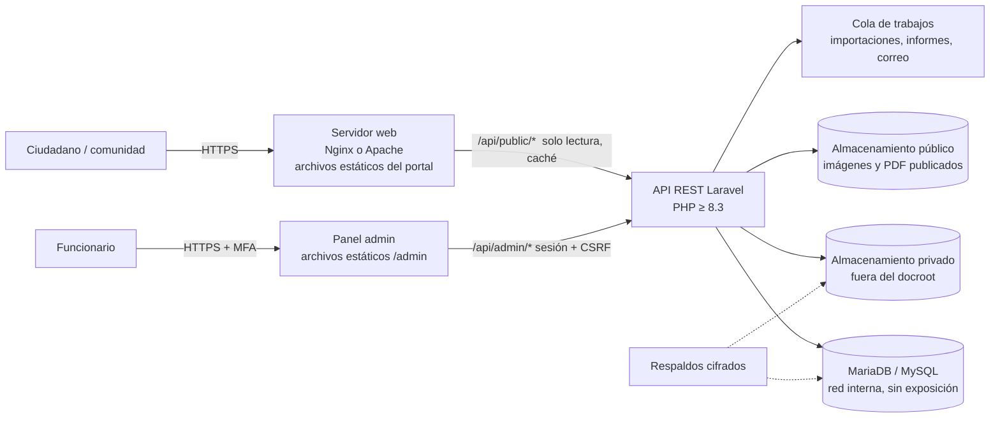

# Fase 1 — Diagnóstico técnico y plan de desarrollo
## Portal institucional de información, indicadores y gestión del IDEAD – Universidad del Tolima

| Campo | Valor |
|---|---|
| Versión | 0.1 — borrador para aprobación |
| Fecha | 2026-11-09 |
| Estado | **En espera de aprobación** (no se ha escrito código de la aplicación) |
| Documentos relacionados | [02 Matriz de indicadores](02-matriz-indicadores.md) · [03 Modelo de datos preliminar](03-modelo-datos-preliminar.md) · [04 Roles y permisos](04-roles-permisos.md) · [05 Compatibilidad tecnológica](05-compatibilidad-tecnologica.md) |

---

## 0. Resumen ejecutivo

1. **Insumos analizados.** Se recibió y analizó completo el Excel *Indicadores Sugeridos* (1 hoja, 102 filas, 13 apartados, **76 indicadores**, glosario de 15 abreviaturas). **No se recibió el Documento 1 (boceto del portal)**, y el repositorio `BLOG_IDEAD` estaba vacío (sin commits). El análisis visual queda bloqueado hasta recibir el boceto.
2. **Cobertura.** Los 76 indicadores tienen código estable, módulo, ruta, visualización, filtros, fuente y nivel de publicación asignados en la [matriz](02-matriz-indicadores.md). 51 son publicables directamente, 18 solo de forma agregada con supresión de celdas pequeñas, 2 contienen datos sensibles que requieren autorización expresa y 5 combinan información pública con soportes restringidos.
3. **Ningún indicador tiene metodología oficial en el Excel.** El Excel define *qué* mostrar y *de dónde* sale, pero no *cómo* se calcula. Todos quedan marcados “Metodología pendiente de validación”; el sistema permitirá publicar valores entregados por la fuente, pero no calculará tasas por su cuenta hasta validar las fórmulas.
4. **Arquitectura recomendada.** Frontend React + TypeScript + Vite compilado a archivos estáticos (no exige Node.js en el servidor) + API REST en **Laravel sobre PHP ≥ 8.3** + **MariaDB 10.11/11.4 LTS o MySQL 8.4 LTS**. **PHP 5.6.40 se descarta** para el backend por estar sin soporte desde 2018; si el servidor actual no puede actualizarse, se propone un servidor/VM independiente (ver §6 y [05](05-compatibilidad-tecnologica.md)).
5. **Modelo de datos genérico para indicadores** (catálogo + valores históricos dimensionados + lotes de carga con flujo de revisión), de forma que agregar un indicador nuevo no requiera modificar tablas.
6. **RBAC con permisos granulares** y separación de funciones: el Administrador técnico **no** hereda acceso a documentos financieros ni contractuales; quien registra un dato no puede aprobarlo.
7. **Se requieren 14 decisiones/insumos institucionales** (§10) antes o durante el desarrollo; las más urgentes son: el boceto, el manual de identidad visual, la información del servidor y la lista oficial de CAT.

---

## 1. Insumos recibidos y estado del repositorio

| Insumo | Estado | Observación |
|---|---|---|
| Documento 1 — Boceto / diseño preliminar | ❌ **No recibido** | Solo llegó el Excel adjunto. Se necesita en PDF, imagen, Figma o enlace. |
| Documento 2 — `Indicadores Sugeridos.xlsx` | ✅ Analizado al 100 % | Copia de trazabilidad en `docs/referencias/Indicadores_Sugeridos.xlsx`. |
| Repositorio `BLOG_IDEAD` (rama `claude/sharp-hypatia-7yrovx`) | Vacío | No existe código previo que conservar. |
| Manual de identidad UT / IDEAD (logos, colores, tipografías) | ❌ No recibido | No se inventarán logotipos ni colores (ver §2). |
| Datos del servidor de alojamiento | ❌ No recibido | Evaluación hecha por escenarios ([05](05-compatibilidad-tecnologica.md)). |
| Datos institucionales reales (cifras, CAT, programas) | ❌ No recibidos | El portal mostrará “Información pendiente de actualización”. |

---

## 2. Análisis del boceto (Documento 1)

**Estado: bloqueado por falta del archivo.** No es posible —ni honesto— describir distribución, secciones, navegación, colores o tipografías de un documento que no se ha visto.

Cuando se reciba, el análisis cubrirá esta lista de verificación, y cada decisión quedará registrada como *se conserva / se mejora / se reemplaza (con justificación)*:

- Retícula y distribución (encabezado, hero, bloques, pie).
- Secciones existentes vs. las 15 secciones exigidas por el prompt y los 13 módulos del Excel (detectar faltantes y sobrantes).
- Navegación propuesta (menú, submenús, accesos rápidos, buscador, acceso privado).
- Paleta, tipografías, iconografía, uso de fotografía.
- Componentes repetibles (tarjetas, cifras, gráficos, noticias) → biblioteca de componentes.
- Problemas de accesibilidad (contraste, tamaño de texto, foco) y de comportamiento responsive.

**Mientras tanto** la arquitectura de interfaz se diseña con *design tokens* (variables CSS de color, tipografía, espaciado, radios, sombras). Los valores definitivos se tomarán del boceto y del manual de identidad oficial; cambiar la identidad no requerirá tocar componentes. No se usará ningún logotipo hasta recibir los archivos oficiales (en su lugar, un espacio reservado rotulado “Logotipo oficial — pendiente”).

---

## 3. Análisis completo de los 13 apartados del Excel

### 3.1 Estructura del archivo

- Una hoja (`Hoja1`, rango A1:G102). Cada apartado inicia con un título fusionado (A:D) seguido de un encabezado *Nombre sugerido del apartado | Información que se desea mostrar | Visualización sugerida | Fuente*.
- Las columnas F:G contienen un glosario de 15 abreviaturas.
- Total: **13 apartados y 76 indicadores** (6+8+5+8+6+5+7+5+5+4+5+7+5). El detalle completo está en la [matriz](02-matriz-indicadores.md) y en [`matriz-indicadores.csv`](matriz-indicadores.csv), generados programáticamente desde el Excel para garantizar que no se omita ninguna fila (`scripts/generar_matriz_indicadores.py`).

### 3.2 Síntesis por módulo

| # | Módulo | Ind. | Fuentes principales | Visualizaciones dominantes | Hallazgos clave |
|---|---|---|---|---|---|
| 1 | Oferta académica y acceso | 6 | Página web, BD matriculados, DARCA, Acuerdos | KPI, listados, barras comparativas, línea de tiempo | Falta definir “programa que recibe estudiantes nuevos” y las fórmulas de ocupación. |
| 2 | Estudiantes y matrícula | 8 | BD matriculados, BD representantes, CDIDEAD | KPI, líneas, barras, mapa, distribución % | Contiene datos sensibles (etnia, discapacidad, víctimas): solo agregados con supresión. Falta fecha de corte de matrícula. |
| 3 | Permanencia y resultados | 5 | BD matriculados, SAIDEAD, ICFES, DP | Líneas, barras apiladas | La deserción debe excluir graduados/egresados y diferenciar 4 situaciones; metodología pendiente. |
| 4 | Docentes | 8 | BD departamentos, SAIDEAD, Informe SNIES, “profesor Llanos” | KPI, líneas, barras | Fuente nominal a una persona; definir relación estudiantes/docente (personas vs. TCE). |
| 5 | Graduados | 6 | SGUT, SAIDEAD, Oficina de Graduados, SNIES | Dos KPI, líneas, barras, mapa | Personas graduadas ≠ títulos otorgados (dos métricas). Seguimiento laboral depende de datos externos. |
| 6 | Personal administrativo | 5 | CRIDEAD, Informe SNIES | KPI, barras, mapa | Planta y contratistas por separado; contratos individuales solo en panel privado. |
| 7 | CAT e infraestructura | 7 | CRIDEAD, Coordinadores, “Actores claves” | Mapa, tablas, línea de tiempo, ficha | Requiere listado oficial y coordenadas verificadas. El indicador 7.7 se arma reutilizando datos de otros módulos. |
| 8 | Bienestar y TUIDEAD | 5 | Informe SNIES, TUIDEAD, Operadores, Biblioteca, CRIDEAD | KPI por servicio, barras, mapa | Separar personas únicas vs. participaciones; servicios de salud = datos sensibles. |
| 9 | Investigación | 5 | SAIDEAD, VICIEPS, PIDEAD, DP, CP | KPI, listados, barras por tipo | Requiere catálogo de tipos de producto y estados de proyecto. |
| 10 | Extensión y formación continua | 4 | PSIDEAD, DP, ECIDEAD | KPI, mapa, listados | Participantes ≠ certificados. |
| 11 | Gestión financiera | 5 | PRIDEAD | KPI, líneas, barras comparativas, avance % | Asignado/comprometido/ejecutado; “costo real por estudiante” requiere metodología y autorización. |
| 12 | Proyectos y gestión | 7 | CRIDEAD, PRIDEAD, OPDI, “CIBAGUE”, PIDEAD | KPI por estado, tabla, mapa, ficha | Abreviaturas no definidas o inconsistentes (ver §4). |
| 13 | Calidad y recursos digitales | 5 | ACIDEAD, SAIDEAD, CRIDEAD | Listados, barras, % | Confirmar vigencia de TuAula y CloudLabs; instrumento de satisfacción. |

### 3.3 Glosario de fuentes

**Definidas en el Excel (columnas F:G):** BD (Base de datos), DARCA (Dirección de Admisión, Registro y Control Académico), CDIDEAD (Consejo Directivo IDEAD), ICFES, DP (Direcciones de programa), SAIDEAD (Secretaría Académica IDEAD), SNIES, CRIDEAD (Centros Regionales IDEAD), VICIEPS (Vicerrectoría de Investigación, Creación, Innovación, Extensión y Proyección Social), PIDEAD (Publicaciones IDEAD), CP (Coordinación de Programas), PSIDEAD (Proyección Social IDEAD), ECIDEAD (Educación Continuada IDEAD), PRIDEAD (Presupuesto IDEAD), ACIDEAD (Aseguramiento de la Calidad IDEAD).

**Usadas pero NO definidas en el Excel** (pendientes de que la institución confirme su nombre oficial): TUIDEAD, SGUT, OPDI, CIBAGUE, CAT, CRAI, Oficina de Graduados, Biblioteca, “Informes Operadores”, “Permanencia Estudiantes”, “Actores claves”, “profesor Llanos”, “Página web”, “Acuerdos”, “Información previamente recolectada”, BD departamentos, BD representantes. No se les asignará un significado inventado: en la base de datos quedarán registradas como fuentes con el estado *“nombre oficial pendiente de validación”*.

### 3.4 Categorías de datos y su tratamiento

| Tipo | Ejemplos | Tratamiento |
|---|---|---|
| Cifras institucionales agregadas | matrícula total, presupuesto anual | Públicas tras aprobación. |
| Agregados con riesgo de reidentificación | promedios por programa-CAT, perfil por edad/sexo | Supresión de celdas con n < *k* (propuesta: k = 5, a validar). |
| Datos sensibles (Ley 1581 de 2012, art. 5) | etnia, discapacidad, víctimas, salud (psicología/enfermería) | Solo agregados a nivel IDEAD o CAT, con supresión y autorización expresa por indicador. |
| Información restringida | contratos, facturas, caja menor, soportes financieros, datos personales de funcionarios | Solo en el panel privado, almacenamiento privado, permiso explícito. |

---

## 4. Contradicciones, vacíos y requerimientos que necesitan autorización

### 4.1 Contradicciones o inconsistencias detectadas

| # | Hallazgo | Ubicación | Propuesta |
|---|---|---|---|
| C1 | **PIDEAD** = “Publicaciones IDEAD” en el glosario, pero es la fuente de “Cumplimiento de metas del plan operativo” (función típica de planeación). | Excel D95 | Confirmar si es otra dependencia (¿Planeación IDEAD?). |
| C2 | **CIBAGUE** no aparece en el glosario. | Excel D94 | Confirmar significado. |
| C3 | “**profesor Llanos**” figura como fuente: es una persona, no una dependencia; publicarlo expone un nombre y crea dependencia de una persona. | D34, D69, D70 | Sustituir por la dependencia o grupo institucional correspondiente. |
| C4 | **CRIDEAD** = “Centros Regionales IDEAD” aparece como fuente de personal administrativo, presupuesto de proyectos y convenios. | Módulos 6, 12 | Confirmar que CRIDEAD es responsable de esos datos. |
| C5 | El prompt menciona **15 secciones** del portal, y el Excel **13 apartados**. | Prompt §5 vs. Excel | No es contradicción: 13 módulos + Inicio + Noticias = 15. Se adopta así. |
| C6 | El prompt pide entidades “Matrículas, Docentes, Graduados, Personal” (sugiere microdatos) y a la vez publicar solo agregados y proteger datos personales. | Prompt §12 vs. §14 | **Decisión D6** (§10): recomendamos almacenar solo agregados en la fase inicial. |
| C7 | Hoja sin encabezado “Fuente” en los apartados 2 a 13 (solo en el 1). | Excel D10, D20… | Sin impacto: se asume que la columna D es la fuente en todos. |
| C8 | M01-I03 cita como fuente “BD matriculados comparando”, pero los cupos *aprobados* normalmente salen de actos del CDIDEAD. | Excel D5 | Confirmar fuente de cupos aprobados. |

### 4.2 Datos faltantes

- Definición, fórmula, unidad, periodicidad y fecha de corte de cada indicador (los 76).
- Listado oficial de CAT, sedes, municipios, coordenadas, horarios, contactos y responsables autorizados.
- Catálogo oficial de programas (código SNIES, nivel, área, estado del registro calificado).
- Catálogo de dependencias y responsables de cada fuente.
- Series históricas: ¿desde qué año/semestre se publicarán?
- Archivos oficiales de identidad gráfica.
- Política de privacidad y aviso de tratamiento de datos de la UT a enlazar en el pie de página.
- Noticias e imágenes iniciales con autorización de uso.

### 4.3 Requerimientos que necesitan autorización institucional

1. Publicación de los indicadores `AGR-S` (M02-I07 caracterización poblacional; M08-I03 servicios de salud de bienestar).
2. Publicación del “costo real por estudiante” (M11-I05).
3. Publicación de nombres de responsables de CAT y representantes estudiantiles.
4. Uso de fotografías de personas (autorización de imagen).
5. Uso público de resultados ICFES por programa y CAT.
6. Alojamiento: uso del servidor institucional o de infraestructura nueva; certificado HTTPS; subdominio (p. ej. `idead.ut.edu.co` u otro que defina la Oficina de TI).
7. Eventual integración automática con sistemas de DARCA/SGUT/PRIDEAD (requiere aval de cada dueño de datos).
8. Uso de un proveedor de mapas base (o, alternativamente, mapa vectorial sin proveedor externo; ver §6.3).

---

## 5. Estructura de navegación propuesta

```
Inicio  /
├── Oferta académica                     /oferta-academica          (Módulo 1)
├── Estudiantes ▾
│   ├── Estudiantes y matrícula          /estudiantes               (Módulo 2)
│   ├── Permanencia y resultados         /permanencia               (Módulo 3)
│   └── Bienestar y TUIDEAD              /bienestar                 (Módulo 8)
├── Comunidad ▾
│   ├── Docentes                         /docentes                  (Módulo 4)
│   ├── Graduados                        /graduados                 (Módulo 5)
│   └── Personal administrativo          /personal-administrativo   (Módulo 6)
├── Territorio (CAT)                     /cat  ·  /cat/:slug        (Módulo 7)
├── Investigación y extensión ▾
│   ├── Investigación                    /investigacion             (Módulo 9)
│   └── Extensión y formación continua   /extension                 (Módulo 10)
├── Gestión ▾
│   ├── Gestión financiera               /gestion-financiera        (Módulo 11)
│   ├── Proyectos y gestión              /proyectos · /proyectos/:slug (Módulo 12)
│   └── Calidad y recursos digitales     /calidad                   (Módulo 13)
├── Noticias                             /noticias · /noticias/:slug
├── Buscar                               /buscar?q=
└── [Acceso funcionarios]                /admin  (aplicación separada, ver §6)

Pie: /transparencia (todas las fuentes y metodologías) · /privacidad · /accesibilidad · /contacto · /mapa-del-sitio
```

- El menú agrupa los 13 módulos en 6 entradas de primer nivel para evitar un menú de 15 elementos; en móvil se convierte en panel lateral accesible.
- Cada indicador tiene ancla propia (`/estudiantes#M02-I03`) para que el buscador y los informes enlacen directamente.
- Página de **Inicio**: encabezado, hero, 6 cifras destacadas (cada una enlazada a su indicador y fuente), tarjetas de los 13 módulos, noticias, mapa de cobertura (solo con coordenadas verificadas) y pie.
- Página **/transparencia**: catálogo completo de indicadores con su ficha técnica (fuente, dependencia, metodología y estado de validación).

---

## 6. Arquitectura propuesta

### 6.1 Vista general



### 6.2 Decisiones y justificación

| Capa | Elección | Por qué | Alternativa descartada |
|---|---|---|---|
| Frontend público y panel | **React 18/19 + TypeScript + Vite**, React Router | Componentes reutilizables, tipado estricto que reduce errores, compilación a HTML/CSS/JS estáticos: **no exige Node.js en el servidor** (solo en la máquina de construcción). | Renderizado en servidor con Node (exigiría Node en producción). |
| Estilos | **Tailwind CSS** + *design tokens* en variables CSS | Coherencia visual, CSS final pequeño, la identidad institucional se aplica cambiando tokens. | CSS-in-JS (más peso en tiempo de ejecución). |
| Gráficos | **Recharts** (sobre SVG) | Declarativo en React, accesible (SVG con títulos/descripciones), suficiente para barras, líneas, áreas, distribuciones. | Chart.js (canvas, menos accesible para lectores de pantalla). |
| Mapas | **MapLibre GL** o **Leaflet** con capa GeoJSON de departamentos/municipios (fuente DANE – MGN) servida por el propio portal | No depende de API keys ni de servicios comerciales; el mapa base de calles es opcional y configurable. | Google Maps (licencia, clave, cookies de terceros). |
| Animación | CSS + *View Transitions*; **GSAP solo si el boceto lo justifica** | Peso y rendimiento; se respeta `prefers-reduced-motion`. | — |
| Backend | **Laravel (versión estable con soporte vigente) sobre PHP ≥ 8.3** | Ecosistema PHP conocido en entornos universitarios, ORM con consultas parametrizadas, validación, colas, políticas de autorización, migraciones, pruebas. Mantiene continuidad con el conocimiento PHP de la institución. | Mantener PHP 5.6 (sin parches desde dic-2018: inaceptable). Node/NestJS (válido, pero añade un lenguaje nuevo al equipo de soporte). |
| Autenticación | Sesiones con cookie `HttpOnly`/`Secure`/`SameSite` (Laravel Sanctum en modo SPA) + CSRF + **TOTP (MFA)** para cuentas administrativas; hash **Argon2id** (o bcrypt si la extensión no está disponible) | Evita guardar tokens en `localStorage` (riesgo XSS). | JWT en el navegador. |
| Autorización | Permisos granulares en BD + *Policies* de Laravel por recurso y por dependencia | Configurable sin código, auditable. | Roles fijos en código. |
| Base de datos | **MariaDB 10.11 / 11.4 LTS** o **MySQL 8.4 LTS**, `utf8mb4` | Requerimiento del prompt; soportados por Laravel. | — |
| Archivos | Disco público (solo publicados) + disco privado fuera del *docroot*, descarga solo vía API autorizada con URL firmada de corta duración | Los archivos privados nunca tienen enlace directo. | Una sola carpeta `uploads/`. |
| Importaciones | Plantillas Excel/CSV por indicador, procesadas en cola, con validación previa y vista de diferencias | Las fuentes no tienen API; se habilita la carga manual controlada. | — |

### 6.3 Separación portal público / panel privado

- Dos aplicaciones frontend independientes (`apps/portal` y `apps/admin`) que comparten un paquete de componentes (`packages/ui`). El código del panel **no** se incluye en el paquete que descarga el público.
- Dos grupos de rutas API: `/api/public/v1/*` (solo lectura, solo datos con estado *publicado*, cacheables) y `/api/admin/v1/*` (autenticadas, con permisos). El buscador público consulta exclusivamente el índice de contenido publicado.
- El panel puede alojarse en un subdominio distinto y restringirse por red (VPN o IP institucional) si TI lo decide.

### 6.4 Estructura de carpetas propuesta (monorepo)

```
BLOG_IDEAD/
├── apps/
│   ├── portal/            # React + Vite — portal público
│   └── admin/             # React + Vite — panel privado
├── packages/
│   ├── ui/                # componentes compartidos (tarjetas, gráficos, tablas, filtros, mapa)
│   └── api-client/        # cliente tipado de la API (tipos generados del contrato OpenAPI)
├── backend/               # Laravel: app/Domain/{Indicators,Documents,News,Cat,Projects,Auth,Audit}
│   ├── database/migrations, seeders (catálogo de indicadores desde la matriz)
│   └── tests/             # Feature + Unit (PHPUnit/Pest)
├── docs/                  # diagnóstico, ER, diccionario, API (OpenAPI), manuales
├── scripts/               # utilidades (generación de matriz, respaldos)
└── deploy/                # configuración de servidor web, ejemplos .env, procedimientos
```

### 6.5 Dimensionamiento (preliminar, a validar)

Población de referencia: >7.000 estudiantes, >1.000 docentes, >400 funcionarios. El portal público es mayoritariamente de lectura y cacheable; los picos esperables están en inscripciones, matrícula y publicación de resultados. **No se fijan cifras definitivas de infraestructura**: en la Fase 8 se ejecutarán pruebas de carga (k6) con escenarios de concurrencia acordados con TI (propuesta inicial a validar: 200 usuarios concurrentes en portal y 30 en panel). Como punto de partida para la conversación con TI —no como requisito— un servidor de 2–4 vCPU, 4–8 GB de RAM y 50–100 GB de disco suele bastar para este perfil; el consumo real de almacenamiento dependerá del volumen documental, que hoy se desconoce.

---

## 7. Diseño preliminar del modelo de datos

Detallado en [03-modelo-datos-preliminar.md](03-modelo-datos-preliminar.md). Principios:

- **Indicadores genéricos:** `indicators` (catálogo con ficha técnica) → `indicator_values` (valor + período + dimensiones opcionales: programa, CAT, municipio, departamento, nivel, y una dimensión de desagregación libre: sexo, rango de edad, tipo de vinculación, etc.). Nuevos indicadores = nuevos registros, no nuevas tablas.
- **Historia inmutable:** los valores se cargan en **lotes** (`data_submissions`) que pasan por *borrador → enviado → aprobado/devuelto → publicado*. Una corrección crea un lote nuevo que reemplaza al anterior sin borrarlo.
- **Entidades de ficha:** CAT, sedes, programas, oferta por CAT y período, proyectos, convenios, noticias, documentos.
- **Seguridad y trazabilidad:** usuarios, roles, permisos, alcance por dependencia, historial de cambios y auditoría.

## 8. Roles y permisos

Detallado en [04-roles-permisos.md](04-roles-permisos.md): 6 roles iniciales, 40 permisos atómicos, alcance por dependencia, separación de funciones y matriz rol × permiso.

## 9. Evaluación de compatibilidad tecnológica

Detallada en [05-compatibilidad-tecnologica.md](05-compatibilidad-tecnologica.md): requisitos mínimos, lista de verificación para TI, tres escenarios de despliegue y la posición frente a PHP 5.6.40.

---

## 10. Decisiones pendientes para aprobar

| # | Decisión / insumo | Recomendación | Bloquea |
|---|---|---|---|
| D1 | Entregar el **boceto** (Documento 1) | — | Fase 2 |
| D2 | Entregar **manual de identidad** y logotipos oficiales UT/IDEAD | — | Fase 2 (valores de tokens) |
| D3 | Aprobar stack: React+TS+Vite / Laravel / MariaDB-MySQL | Aprobar | Fases 3–5 |
| D4 | Información del servidor (lista de verificación de [05](05-compatibilidad-tecnologica.md)) y escenario de despliegue | Escenario B si el servidor actual no admite PHP ≥ 8.3 | Fase 9 (el desarrollo puede avanzar en contenedores) |
| D5 | Umbral de supresión de celdas pequeñas (*k*) | k = 5 | Módulos 2, 4, 5, 6, 8 |
| D6 | ¿Almacenar microdatos (registros por persona) o solo agregados? | **Solo agregados** en la fase inicial; las fuentes entregan cifras ya agregadas o plantillas que el sistema agrega sin persistir los registros individuales | Modelo de datos |
| D7 | Quién aprueba cada tipo de información (revisor por dependencia) | Permiso `indicators.review` asignable por dependencia; por defecto, Director | Flujo de publicación |
| D8 | Significado de CIBAGUE, PIDEAD (en metas), fuente “profesor Llanos” y demás fuentes no definidas (§3.3) | — | Catálogo de fuentes |
| D9 | Listado oficial de CAT con coordenadas | — | Mapa y fichas CAT |
| D10 | Autorizaciones de publicación de §4.3 | — | Indicadores AGR-S y MIX |
| D11 | Proveedor de mapa base | Mapa vectorial propio (GeoJSON DANE), sin proveedor externo | Módulo 7 |
| D12 | Desde qué período se publicarán las series históricas | — | Cargas iniciales |
| D13 | Política de MFA | Obligatoria para todos los roles del panel | Autenticación |
| D14 | Servicio de correo institucional (SMTP) para recuperación de contraseña y notificaciones | — | Fase 4 |

---

## 11. Plan de desarrollo por etapas

Cada fase termina con: código en la rama, explicación de archivos creados/modificados, instrucciones de verificación y **resultados de pruebas realmente ejecutadas** (nunca se reportará una prueba no ejecutada).

| Fase | Contenido | Entregables verificables | Depende de |
|---|---|---|---|
| **1. Análisis** *(este documento)* | Diagnóstico, matriz, modelo preliminar, RBAC, compatibilidad | `docs/fase-1/*` | — |
| **2. Diseño de interfaz** | Análisis del boceto; tokens; inventario de componentes; prototipo navegable responsive de Inicio, una plantilla de módulo, ficha CAT, ficha proyecto, noticias, buscador y panel | Prototipo ejecutable (`apps/portal` con datos de demostración rotulados) + capturas en 4 tamaños de pantalla | D1, D2 |
| **3. Frontend** | Componentes `packages/ui` (KPI, barras, líneas, distribución, tabla con exportación CSV, mapa, línea de tiempo, avance, ficha, filtros sincronizados con la URL), 13 módulos, buscador, estados “pendiente” | Pruebas unitarias de componentes (Vitest + Testing Library), pruebas de accesibilidad automáticas (axe) | Fase 2 |
| **4. Backend** | API REST versionada, autenticación + MFA, RBAC, servicios de indicadores/documentos/noticias/CAT/proyectos, validaciones, limitación de intentos, auditoría, contrato OpenAPI | Pruebas de API (PHPUnit/Pest) incluyendo intentos no autorizados | D3, D13, D14 |
| **5. Base de datos** | Migraciones, índices, restricciones, semillas: catálogo de 76 indicadores desde la matriz, fuentes, dependencias; datos de prueba **marcados como demostración** | Diagrama ER, diccionario de datos, script SQL exportado | D5, D6 |
| **6. Panel administrativo** | Usuarios/roles, indicadores y lotes (carga manual e importación Excel/CSV), revisión/publicación, documentos, noticias con programación, CAT, proyectos, convenios, historial | Pruebas E2E (Playwright) de los flujos principales | Fases 4–5 |
| **7. Integración** | Portal y panel conectados a la API; filtros sobre datos reales de prueba; informes PDF/Excel/CSV | E2E portal + panel | Fase 6 |
| **8. Seguridad, pruebas y optimización** | Pruebas de permisos, cargas maliciosas, XSS/SQLi/CSRF, cabeceras de seguridad, Lighthouse, accesibilidad WCAG 2.1 AA, carga (k6) | Informe de resultados de pruebas | Fase 7 |
| **9. Implementación** | Documentación técnica, manuales de usuario y administración, requisitos de servidor, instalación, respaldo y recuperación, mantenimiento | `docs/` completo + scripts de despliegue | D4 |

**Paralelismo:** las fases 4 y 5 pueden avanzar en paralelo a la 2 (no dependen del boceto). Si el boceto tarda, se propone iniciar por la Fase 5 → 4 (modelo de datos y API), que son independientes del diseño visual.

---

## 12. Criterios de calidad que se aplicarán

- Ninguna cifra inventada: sin dato aprobado, el componente muestra “Información pendiente de actualización”; los datos de demostración llevan una marca visible “DATOS DE DEMOSTRACIÓN” y viven en un *seeder* separado que nunca se ejecuta en producción.
- Cada indicador visible muestra: nombre, descripción, valor, unidad, período, fecha de actualización, fuente, dependencia, metodología (o “pendiente de validación”) y observaciones.
- Ningún botón sin acción, formulario sin persistencia ni enlace roto (verificación automatizada de enlaces en la Fase 8).
- Accesibilidad objetivo **WCAG 2.1 nivel AA**: contraste, foco visible, navegación por teclado, etiquetas ARIA, tablas alternativas para cada gráfico.
- Cumplimiento de la Ley 1581 de 2012 y su reglamentación (Decreto 1074 de 2015, que compila el Decreto 1377 de 2013) en el tratamiento de datos personales; y de la Ley 1712 de 2014 (transparencia) como referente para la información pública.
