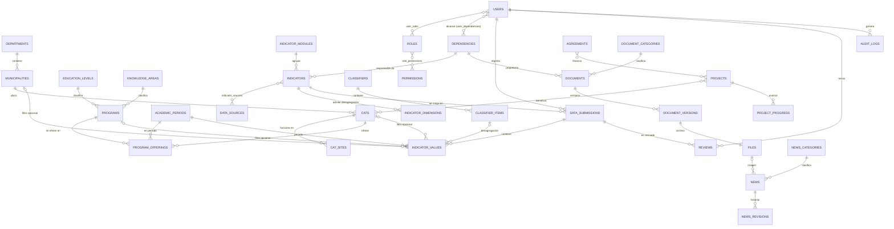

# Modelo de datos preliminar

> Diseño preliminar para aprobación. El diagrama ER definitivo, el diccionario de datos completo y los scripts SQL se entregarán en la Fase 5 como migraciones de Laravel y como script exportado. Motor objetivo: MariaDB 10.11+/MySQL 8.4, `utf8mb4`, InnoDB.

## 1. Principios

1. **Indicadores como datos, no como tablas.** Un indicador nuevo se registra en el catálogo; no exige migraciones.
2. **Historia inmutable.** Los valores se cargan en *lotes*; los lotes publicados no se editan, se reemplazan por un lote nuevo (`supersedes_id`). Así se comparan períodos y se audita qué se publicó en cada fecha.
3. **Solo agregados** en la fase inicial (decisión D6). No hay tablas con registros individuales de estudiantes, docentes o graduados.
4. **Dimensiones conformadas.** Período, programa, CAT, municipio, departamento y nivel son tablas compartidas por indicadores, fichas y filtros.
5. **Integridad referencial** con claves foráneas, restricciones `UNIQUE` y `CHECK`; índices orientados a los filtros del portal.
6. **Datos de demostración identificados** con la columna `is_demo` en lotes y contenidos; la API pública los excluye en producción.

## 2. Diagrama entidad-relación (núcleo)

## 3. Tablas por dominio

### 3.1 Territorio y oferta académica

| Tabla | Campos principales | Restricciones / índices |
|---|---|---|
| `departments` | id, dane_code CHAR(2), name | UNIQUE(dane_code) |
| `municipalities` | id, department_id FK, dane_code CHAR(5), name, lat, lng | UNIQUE(dane_code); IDX(department_id) |
| `cats` | id, slug, name, municipality_id FK, address, lat DECIMAL(9,6) NULL, lng NULL, coords_verified BOOL, history TEXT, phone, email, schedule TEXT, manager_name NULL, manager_public BOOL, opened_on DATE NULL, status ENUM(activo, inactivo, reactivado), publication_status | UNIQUE(slug); IDX(municipality_id, status) |
| `cat_sites` | id, cat_id FK, name, ownership ENUM(publica, privada, propia), address, active | IDX(cat_id) |
| `cat_facilities` | id, cat_site_id FK, facility_type_id FK (aula, laboratorio, sala de cómputo, biblioteca, auditorio, deportivo, bienestar), quantity, capacity, period_id FK | UNIQUE(cat_site_id, facility_type_id, period_id) |
| `cat_events` | id, cat_id FK, event_type ENUM(apertura, cierre, reactivacion), event_date, act_reference | línea de tiempo M07-I05 |
| `education_levels` | id, code, name, cycle ENUM(pregrado, posgrado) | UNIQUE(code) |
| `knowledge_areas` | id, code, name, classification (NBC/CINE-F) | UNIQUE(classification, code) |
| `programs` | id, snies_code NULL, slug, name, level_id FK, area_id FK, department_owner_id FK(dependencies), modality, credits, qualified_registry_until DATE NULL, high_quality_accreditation_until DATE NULL, status ENUM(activo, en_cierre, proyectado, inactivo) | UNIQUE(snies_code); UNIQUE(slug) |
| `academic_periods` | id, code ('2026-2'), year SMALLINT, term TINYINT NULL, type ENUM(semestre, anio, vigencia, cohorte), starts_on, ends_on | UNIQUE(code) |
| `program_offerings` | id, program_id FK, cat_id FK, period_id FK, admits_new BOOL, approved_quota INT NULL, act_reference | UNIQUE(program_id, cat_id, period_id) |

### 3.2 Catálogo de indicadores y valores

| Tabla | Campos principales | Notas |
|---|---|---|
| `indicator_modules` | id, number 1–13, slug, name, description, sort | Los 13 apartados del Excel. |
| `indicators` | id, code ('M02-I03'), module_id FK, name, description, information_required, unit ENUM(personas, títulos, porcentaje, pesos, número, razón…), value_type ENUM(count, ratio, percent, currency, text), periodicity, chart_type, default_filters JSON, publication_level ENUM(PUB, AGR, AGR_S, MIX), min_cell_size TINYINT NULL, methodology TEXT NULL, methodology_status ENUM(pendiente, validada), responsible_dependency_id FK, observations, is_active | UNIQUE(code). Semilla desde `matriz-indicadores.csv`. |
| `data_sources` | id, code (DARCA, SAIDEAD…), name, kind ENUM(dependencia, sistema, base_datos, externo, acto_administrativo), official_name_status ENUM(validado, pendiente) | Glosario del Excel. |
| `indicator_sources` | indicator_id, data_source_id, role ENUM(principal, complementaria) | PK compuesta. |
| `classifiers` / `classifier_items` | id, code ('sexo', 'rango_edad', 'tipo_vinculacion', 'tipo_desercion', 'tipo_producto', 'servicio_bienestar', 'estamento', 'destino_presupuesto'…) / id, classifier_id, code, label, sort | Dimensiones libres sin crear tablas nuevas. |
| `indicator_dimensions` | indicator_id, dimension ENUM(period, program, cat, municipality, department, level, area, classifier), classifier_id NULL, required BOOL | Qué desagregaciones acepta cada indicador; la validación de cargas se basa en esto. |
| `data_submissions` | id, indicator_id FK, period_from_id, period_to_id, status ENUM(borrador, enviado, devuelto, aprobado, publicado, reemplazado), submitted_by FK users, submitted_at, approved_by, approved_at, published_at, supersedes_id FK self NULL, source_file_id FK NULL, source_note, is_demo BOOL | IDX(indicator_id, status). |
| `indicator_values` | id BIGINT, submission_id FK, period_id FK, program_id NULL, cat_id NULL, municipality_id NULL, department_id NULL, level_id NULL, area_id NULL, classifier_item_id NULL, value DECIMAL(20,4) NULL, value_text NULL, is_suppressed BOOL, note | UNIQUE(submission_id, period_id, program_id, cat_id, municipality_id, department_id, level_id, area_id, classifier_item_id) mediante columna generada `dims_hash`; IDX(period_id), IDX(cat_id, period_id), IDX(program_id, period_id). |
| `published_indicator_values` | *vista* | Solo valores de lotes `publicado` y no reemplazados: la única fuente de la API pública. |
| `reviews` | id, submission_id FK, reviewer_id FK, decision ENUM(aprobado, devuelto), comment, created_at | Historial del flujo. |

La **supresión de celdas pequeñas** se aplica al publicar: valores con n < `min_cell_size` se guardan con `is_suppressed = 1` y la API pública devuelve `null` + motivo, nunca el valor.

### 3.3 Proyectos, convenios y contenidos

| Tabla | Campos principales |
|---|---|
| `projects` | id, slug, code, name, objective, description, investment_line_id FK, status ENUM(radicado, aprobado, en_ejecucion, finalizado, suspendido), approved_amount DECIMAL(18,2), executed_amount, progress_pct DECIMAL(5,2) CHECK 0–100, beneficiaries_count, results TEXT, start_date, end_date, publication_status |
| `project_cats`, `project_municipalities` | relación N:M de cobertura territorial |
| `project_progress` | id, project_id, reported_on, progress_pct, executed_amount, note (serie histórica de avance) |
| `agreements` | id, number, counterpart, object, start_date, end_date, status ENUM(vigente, terminado, en_liquidacion), contributed_amount NULL, is_public BOOL, dependency_id |
| `news_categories`, `news` | id, slug, title, summary, body (HTML saneado), cover_file_id, category_id, status ENUM(borrador, en_revision, programada, publicada, despublicada), publish_at, author_id, approved_by |
| `news_revisions` | id, news_id, snapshot JSON, edited_by, created_at |
| `dependencies` | id, code, name, parent_id, is_active (unidades organizativas: DARCA, SAIDEAD, CRIDEAD…) |

### 3.4 Gestión documental

| Tabla | Campos principales |
|---|---|
| `document_categories` | id, code (informe, contrato, convenio, presupuesto, factura, soporte, fotografia, archivo_indicador…), confidentiality_default ENUM(publico, interno, restringido, financiero) |
| `documents` | id, title, category_id, dependency_id, confidentiality ENUM(publico, interno, restringido, financiero), status ENUM(borrador, vigente, archivado), related_type/related_id (proyecto, convenio, CAT, lote…), created_by |
| `document_versions` | id, document_id, version_no, file_id, change_note, uploaded_by, created_at — UNIQUE(document_id, version_no) |
| `files` | id, disk ENUM(public, private), path, original_name, mime, size_bytes, sha256, uploaded_by, scanned_at, scan_result |

### 3.5 Seguridad y auditoría

| Tabla | Campos principales |
|---|---|
| `users` | id, name, email UNIQUE, password (hash Argon2id), mfa_secret (cifrado), mfa_enabled, is_active, last_login_at, password_changed_at |
| `roles`, `permissions`, `role_permissions`, `user_roles` | RBAC configurable |
| `user_dependencies` | user_id, dependency_id — alcance: un coordinador solo opera sobre los indicadores/documentos de sus dependencias |
| `login_attempts` | email, ip, success, created_at (limitación de intentos) |
| `password_resets` | token (hash), expira en 60 min |
| `change_history` | id, entity_type, entity_id, field, old_value, new_value, user_id, created_at |
| `audit_logs` | id, user_id, action (login, logout, publish, download_private, permission_change…), entity_type, entity_id, ip, user_agent, created_at — tabla solo-inserción |
| `settings` | key, value (límites de tamaño de archivo, k de supresión, etc.) |

## 4. Correspondencia con entidades exigidas en el prompt (§12)

| Entidad del prompt | Tabla(s) |
|---|---|
| Usuarios, Roles, Permisos | `users`, `roles`, `permissions`, `role_permissions`, `user_roles`, `user_dependencies` |
| Dependencias | `dependencies` |
| Programas, CAT, Municipios, Departamentos, Períodos | `programs`, `cats`, `cat_sites`, `municipalities`, `departments`, `academic_periods` |
| Matrículas, Docentes, Graduados, Personal administrativo | Valores agregados en `indicator_values` (módulos 2, 4, 5, 6) — ver decisión D6 |
| Indicadores, Categorías, Valores históricos, Fuentes | `indicators`, `indicator_modules`, `indicator_values`, `data_sources`, `indicator_sources`, `classifiers` |
| Noticias, Publicaciones | `news`, `news_categories`, `news_revisions`; publicaciones académicas como documentos públicos (`documents`) |
| Proyectos, Convenios | `projects`, `project_*`, `agreements` |
| Documentos, Archivos | `documents`, `document_versions`, `files` |
| Solicitudes de actualización, Revisiones | `data_submissions`, `reviews` |
| Historial de cambios, Auditoría | `change_history`, `audit_logs` |
