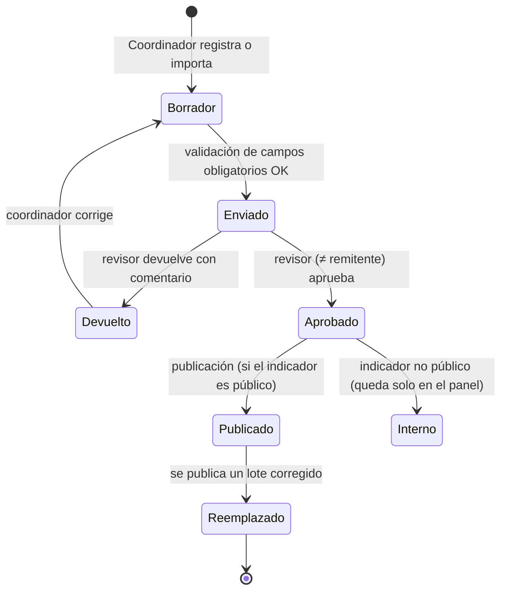

# Roles y permisos (RBAC)

## 1. Principios

1. **Permisos atómicos, roles configurables.** Los roles son conjuntos de permisos editables desde el panel; ningún permiso está “cableado” a un rol en el código.
2. **Mínimo privilegio.** Cada rol recibe solo lo necesario para su función.
3. **Alcance por dependencia.** Los permisos sobre indicadores y documentos se limitan a las dependencias asignadas al usuario (`user_dependencies`), salvo permisos explícitamente globales (`*.any`).
4. **Separación de funciones.** Quien registra o envía un lote de datos no puede aprobarlo (regla validada en el servidor, no solo en la interfaz).
5. **Sin superusuario.** El Administrador técnico administra usuarios y configuración, pero **no** obtiene acceso a documentos financieros, contractuales ni restringidos. Además, no puede asignarse a sí mismo permisos ni roles (otro administrador debe hacerlo, y queda auditado).
6. **Autorización en el backend.** La interfaz oculta lo que el usuario no puede hacer, pero toda decisión se verifica en la API mediante *Policies*.
7. **MFA obligatorio** para cuentas del panel (decisión D13, recomendada).

## 2. Catálogo de permisos

| Grupo | Permisos |
|---|---|
| Indicadores | `indicators.view_internal`, `indicators.submit` (crear/editar lotes en borrador y enviarlos), `indicators.import` (Excel/CSV), `indicators.review` (aprobar/devolver), `indicators.publish`, `indicators.unpublish`, `indicators.catalog.manage` (fichas técnicas, metodología) |
| Informes | `reports.public.export`, `reports.internal.view`, `reports.internal.export`, `reports.financial.view` |
| Documentos | `documents.view.public`, `documents.view.internal`, `documents.view.restricted`, `documents.view.financial`, `documents.upload`, `documents.edit`, `documents.classify`, `documents.archive`, `documents.versions.manage` |
| Contratos y convenios | `agreements.view`, `agreements.manage` |
| Caja menor | `petty_cash.view`, `petty_cash.manage` (presupuestos, facturas, soportes) |
| Noticias | `news.create`, `news.edit`, `news.review`, `news.publish`, `news.unpublish`, `media.manage` |
| CAT | `cats.edit`, `cats.publish` |
| Proyectos | `projects.edit`, `projects.publish` |
| Usuarios y seguridad | `users.view`, `users.manage`, `roles.manage`, `permissions.assign`, `audit.view`, `settings.manage` |

## 3. Matriz rol × permiso (configuración inicial propuesta)

Leyenda: ✔ concedido · **D** limitado a sus dependencias · — no concedido

| Permiso | Director IDEAD | Adm. documental | Caja menor | Comunicaciones | Coordinador / responsable | Adm. técnico |
|---|---|---|---|---|---|---|
| `indicators.view_internal` | ✔ | — | — | — | D | — |
| `indicators.submit` / `import` | — | — | — | — | D | — |
| `indicators.review` | ✔ | — | — | — | — (configurable, D7) | — |
| `indicators.publish` / `unpublish` | ✔ | — | — | — | — | — |
| `indicators.catalog.manage` | ✔ | — | — | — | — | — |
| `reports.internal.view` / `export` | ✔ | — | — | — | D | — |
| `reports.financial.view` | ✔ | — | D | — | — | — |
| `documents.view.internal` | ✔ | ✔ | D | — | D | — |
| `documents.view.restricted` | ✔ | ✔ | — | — | — | — |
| `documents.view.financial` | ✔ | — | ✔ | — | — | — |
| `documents.upload` / `edit` | — | ✔ | ✔ (financieros) | ✔ (fotografías) | D | — |
| `documents.classify` / `versions.manage` / `archive` | — | ✔ | — | — | — | — |
| `agreements.view` | ✔ | ✔ | — | — | — | — |
| `agreements.manage` | — | ✔ (asignados) | — | — | — | — |
| `petty_cash.view` | ✔ | — | ✔ | — | — | — |
| `petty_cash.manage` | — | — | ✔ | — | — | — |
| `news.create` / `edit` / `media.manage` | — | — | — | ✔ | — | — |
| `news.review` / `publish` | ✔ | — | — | ✔ (tras autorización, ver nota) | — | — |
| `cats.edit` | — | — | — | — | D (CRIDEAD) | — |
| `cats.publish`, `projects.publish` | ✔ | — | — | — | — | — |
| `projects.edit` | — | — | — | — | D | — |
| `users.view` / `users.manage` | — | — | — | — | — | ✔ |
| `roles.manage` / `permissions.assign` | — | — | — | — | — | ✔ (no sobre sí mismo) |
| `audit.view` | ✔ | — | — | — | — | ✔ |
| `settings.manage` | — | — | — | — | — | ✔ |

**Notas**

- *Comunicaciones* publica “previa autorización”: se propone que una noticia en estado `en_revision` requiera la aprobación de un usuario con `news.review` distinto del autor. La institución decide si el rol Comunicaciones conserva `news.publish` directo para noticias urgentes.
- *Director* consulta y aprueba; no carga datos para no ser juez y parte. Puede delegarse `indicators.review` a revisores por dependencia (D7).
- El acceso a cualquier documento `restringido` o `financiero` y cada descarga privada quedan registrados en `audit_logs`.

## 4. Flujo de publicación de indicadores

Cada transición guarda usuario, fecha y comentario (`reviews`, `change_history`, `audit_logs`), de modo que siempre se puede responder **quién suministró, quién revisó y cuándo se publicó** cada cifra.
