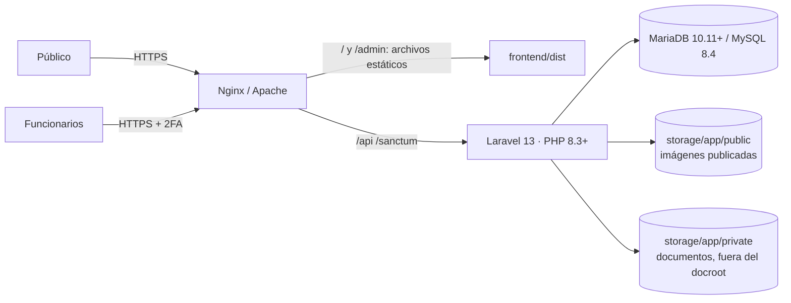

# Documentación técnica — Arquitectura

## 1. Visión general



| Capa | Tecnología | Ubicación |
|---|---|---|
| Portal público | React 19 + TypeScript + Vite 8, Tailwind CSS 4, Recharts, d3-geo | `frontend/index.html`, `frontend/src/portal` |
| Panel privado | React + TypeScript (entrada independiente, no se descarga en el portal) | `frontend/admin/index.html`, `frontend/src/admin` |
| Código compartido | Cliente API, formatos, íconos, tabla consultable, estados | `frontend/src/shared` |
| API | Laravel 13 (PHP ≥ 8.3), Sanctum (sesión SPA), OpenSpout (Excel/CSV), Google2FA (TOTP), Symfony HtmlSanitizer | `backend/` |
| Base de datos | MariaDB 10.11 (probado), MySQL 8.4 o SQLite (desarrollo/pruebas) | `backend/database/migrations` |
| Mapa | GeoJSON de departamentos DANE – MGN servido por el propio portal (sin proveedores externos) | `frontend/public/geo` |

## 2. Estructura de carpetas

```
backend/
  app/Http/Controllers/Public/PortalController.php   API pública (solo lectura, caché versionada)
  app/Http/Controllers/Admin/                         API del panel (auth, usuarios, indicadores, lotes, documentos, recursos CRUD)
  app/Http/Middleware/                                EnsureActiveUser (usuario activo + 2FA obligatorio), SecurityHeaders
  app/Models/ (+ Concerns/TracksChanges, SanitizesHtml) 42 modelos; historial automático y saneamiento HTML
  app/Services/                                       IndicatorQuery, SubmissionService, ContentWorkflow, FileStorage, Settings
  app/Support/                                        Audit, Html, PublicCache, TableExporter
  database/migrations/                                Esquema (fuente de verdad)
  database/seeders/                                   BaseCatalogSeeder (catálogo real), DemoDataSeeder (demostración)
  database/data/                                      indicators.json (76), classifiers.json (55), departamentos.json
  tests/Feature/                                      Pruebas de seguridad, flujo de indicadores y portal
frontend/
  src/portal/  (pages, components: Layout, HomeBlocks, ColombiaMap, IndicatorCard, Charts, Widgets, Filters)
  src/admin/   (auth, resources.tsx — configuración declarativa de 27 recursos —, components/Form, ResourcePage, pages)
  src/shared/  (api, format, icons, types, ui, DataTable)
deploy/        nginx.conf, apache-vhost.conf, backup.sh, crontab.example, idead-queue.service
scripts/       generadores de la matriz, configuración de indicadores y diccionario de datos
docs/          diagnóstico (fase-1), técnica, manuales, pruebas
```

## 3. Modelo de indicadores

- `indicators` guarda la ficha técnica (unidad, tipo de valor, periodicidad, visualización, desagregación principal, dimensiones admitidas, nivel de publicación, umbral *k*, metodología y su estado, dependencia responsable, autorización de publicación).
- Las dimensiones admitidas se guardan como JSON (`allowed_dimensions`) en lugar de la tabla `indicator_dimensions` propuesta en la Fase 1: misma capacidad, menos uniones. Las desagregaciones libres usan **clasificadores** (`classifiers` / `classifier_items`); `is_partition` indica si las categorías suman el total (sexo, estrato) o son medidas distintas que nunca se suman (inscritos/admitidos/matriculados).
- Los valores (`indicator_values`) pertenecen a **lotes** (`data_submissions`) con el flujo `borrador → enviado → (devuelto) → aprobado → publicado → reemplazado/retirado`. Un lote publicado nunca se edita: una corrección crea un lote nuevo que lo reemplaza, conservando la historia.
- `IndicatorQuery` calcula para el portal: cifra del último período, tendencia, desagregación, series por grupo y filas. Nunca suma porcentajes, razones ni promedios; un total derivado se marca como tal.
- Supresión de celdas pequeñas: al publicar, los conteos 0 < n < *k* de indicadores `AGR`/`AGR_S` se marcan como reservados y la API pública devuelve `null`.
- Los indicadores `AGR_S` (caracterización poblacional, servicios de salud de bienestar) no se publican hasta que la Dirección marque «Publicación autorizada».

## 4. Seguridad implementada

| Requisito | Implementación |
|---|---|
| HTTPS | Configuración de servidor (`deploy/`); cookie `Secure`, HSTS |
| Contraseñas | Hash bcrypt (cast `hashed`), política de 12+ caracteres con mayúsculas, minúsculas, números y símbolos |
| Autenticación | Sesión de servidor con cookie `HttpOnly`/`SameSite=Lax` + CSRF (Sanctum SPA); sin tokens en `localStorage` |
| 2FA | TOTP (RFC 6238); obligatorio para todos si se activa en Configuración; restablecimiento por el administrador |
| Intentos de acceso | 5 fallos por correo+IP → bloqueo 15 min; 10 solicitudes/min por IP a rutas de autenticación |
| Autorización | 35 permisos atómicos, 6 roles editables, alcance por dependencia, verificación en el servidor en cada endpoint |
| Separación de funciones | Quien registra/envía un lote o redacta un contenido no puede aprobarlo; nadie modifica sus propios roles |
| Administrador técnico | Sin acceso a documentos financieros/restringidos ni a datos de indicadores |
| Inyección SQL | Consultas parametrizadas (Eloquent/Query Builder); `LIKE` escapado en el buscador |
| XSS | React escapa por defecto; HTML enriquecido saneado en el servidor (lista blanca) al guardar; CSP de ejemplo en Nginx |
| Archivos | Lista blanca de extensión **y** MIME real (fileinfo), verificación de imagen, bloqueo de dobles extensiones/ejecutables/SVG, nombres aleatorios, tamaño máximo configurable, documentos en disco privado servidos solo por la API con auditoría |
| Datos personales | Solo agregados; supresión de celdas; autorización expresa para datos sensibles; nombres de responsables solo si se autoriza |
| Trazabilidad | `change_history` (antes/después por campo, automático), `reviews` (decisiones del flujo), `audit_logs` (accesos, fallos, publicaciones, descargas privadas, cambios de permisos, exportaciones) |
| Cabeceras | `X-Content-Type-Options`, `X-Frame-Options`, `Referrer-Policy`, `Permissions-Policy`, `Cache-Control: no-store` en el panel |
| Base de datos | Solo accesible por `localhost`/red interna; usuario con privilegios limitados a su base |

## 5. Rendimiento

- Caché de la API pública con versión: cualquier escritura incrementa la versión y lo publicado aparece de inmediato (TTL 10 min como respaldo).
- Índices en períodos, CAT, programas y estados; consultas con carga anticipada (`with`).
- Portal con carga diferida por sección; el panel es un paquete aparte; fuentes autoalojadas; imágenes con `loading="lazy"`.
- Paginación en listados públicos y del panel; tablas consultables paginadas en el cliente.

## 6. Cambios respecto al diagnóstico de la Fase 1

| Fase 1 | Implementado | Motivo |
|---|---|---|
| `apps/portal` y `apps/admin` separados | Un proyecto Vite con dos entradas independientes | Mismo aislamiento del paquete del panel con menos configuración |
| Tabla `indicator_dimensions` | Columna JSON `allowed_dimensions` + `classifier_id` | Más simple, igual de validable |
| Permisos `news.*` | `content.create`, `content.publish`, `content.site`, `media.manage`, `entities.publish`, `lists.edit`, `scope.all_dependencies` | Cubren actividades, multimedia, páginas, fichas y listados con el mismo flujo |
| Argon2id | bcrypt (12 rondas) | Disponible en cualquier PHP; se cambia con `HASH_DRIVER=argon2id` si el servidor tiene `sodium` |
| Navegación de 6 grupos | Menú del boceto: Inicio, CAT, Programas, Actividades, Proyectos, Noticias, Multimedia, Estadísticas (13 módulos), Transparencia, Sobre IDEAD | Se conserva el boceto aprobado |
| Entidades Actividades, Multimedia, Equipo, Carrusel | Agregadas | Aparecen en el boceto |
