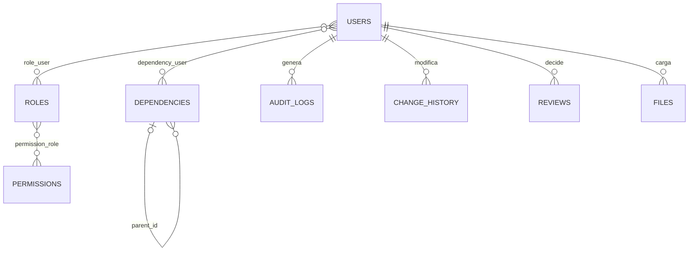
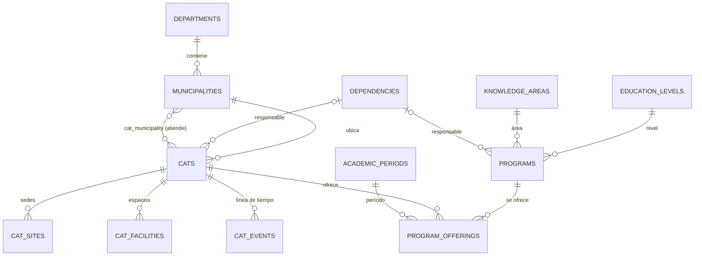
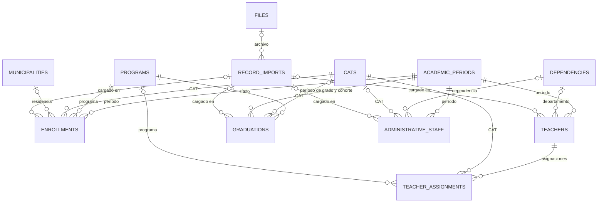
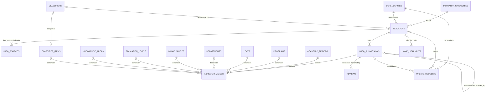
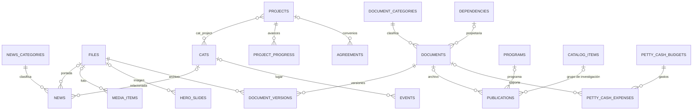

# Modelo de datos — Portal IDEAD

| | |
|---|---|
| Motor | MariaDB 10.11 (probado); compatible con MariaDB 10.6+ / MySQL 8.0+; `utf8mb4_unicode_ci` |
| Tablas | 66 en total: **58 del negocio** + 8 técnicas de Laravel (sesiones, caché, colas, migraciones) |
| Integridad | 120 claves foráneas, restricciones `UNIQUE`, índices por período, CAT, programa y estado |
| Scripts | [`backend/database/sql`](../../backend/database/sql): `00_crear_base_y_usuario.sql`, `01_estructura.sql`, `02_catalogo.sql` |
| Diccionario | [diccionario-datos.md](diccionario-datos.md): campos, tipos, nulos, claves, valores por defecto, referencias e índices de cada tabla, generado desde la base real |
| Fuente de verdad | `backend/database/migrations` (los scripts SQL se regeneran desde allí) |

## 1. Correspondencia con las entidades exigidas (punto 12 del prompt)

| Entidad del prompt | Tabla(s) | Observación |
|---|---|---|
| Usuarios | `users` | Contraseña con hash; secreto 2FA cifrado |
| Roles | `roles`, `role_user` | 6 roles iniciales, configurables |
| Permisos | `permissions`, `permission_role` | 35 permisos atómicos |
| Dependencias | `dependencies`, `dependency_user` | Alcance de cada usuario sobre los datos |
| Programas académicos | `programs`, `program_offerings`, `education_levels`, `knowledge_areas` | Oferta por CAT y período, cupos, admite nuevos |
| CAT | `cats`, `cat_sites`, `cat_facilities`, `cat_events`, `cat_municipality` | Sedes, espacios, línea de tiempo, municipios atendidos |
| Municipios | `municipalities` | Código DANE (DIVIPOLA) |
| Departamentos | `departments` | 33, código DANE (MGN) |
| Períodos académicos | `academic_periods` | Semestres, años, vigencias, cohortes |
| **Matrículas** | `enrollments` | Un registro por estudiante, programa y período (datos personales cifrados) |
| **Docentes** | `teachers`, `teacher_assignments` | Vinculación, formación, categoría, carga por CAT/programa |
| **Graduados** | `graduations` | Un registro por **título**; personas = claves distintas |
| **Personal administrativo** | `administrative_staff` | Planta y contratistas separados por `staff_type` |
| Indicadores | `indicators` | Ficha técnica de los 76 indicadores |
| Categorías de indicadores | `indicator_categories` | Los 13 apartados del Excel |
| Valores históricos de indicadores | `indicator_values` | Nunca se sobrescriben: cada carga es un lote nuevo |
| Fuentes de información | `data_sources`, `data_source_indicator` | 33 fuentes; estado de validación del nombre oficial |
| Noticias | `news`, `news_categories` | Flujo editorial y programación |
| **Publicaciones** | `publications` | Producción académica y publicaciones institucionales |
| Proyectos | `projects`, `project_progress`, `cat_project` | Ficha, avance histórico, CAT beneficiados |
| Convenios | `agreements` | Públicos o no |
| Documentos | `documents`, `document_versions`, `document_categories` | Confidencialidad y control de versiones |
| Archivos | `files` | Disco público/privado, hash SHA-256 |
| **Solicitudes de actualización** | `update_requests` | La Dirección solicita a una dependencia actualizar información, con fecha límite |
| Revisiones | `reviews` | Decisiones del flujo (enviado, aprobado, devuelto, publicado…) |
| Historial de cambios | `change_history` | Valor anterior y nuevo por campo, automático |
| Registros de auditoría | `audit_logs` | Accesos, fallos, publicaciones, descargas, permisos, exportaciones |

Complementarias: `data_submissions` (lotes de datos), `classifiers`/`classifier_items` (desagregaciones: sexo, edad, estrato…), `record_imports` (cargas de registros de personas), `catalog_items` (grupos, semilleros, plataformas, formación continua…), `events`, `media_items`, `hero_slides`, `home_highlights`, `team_units`, `pages`, `petty_cash_budgets`, `petty_cash_expenses`, `settings`.

## 2. Diagramas entidad-relación

### 2.1 Seguridad y trazabilidad



### 2.2 Territorio y oferta académica



### 2.3 Registros institucionales (parte privada, datos personales cifrados)



### 2.4 Indicadores, lotes, revisiones y solicitudes



### 2.5 Contenidos, proyectos y documentos



## 3. Reglas de diseño

1. **Normalización (3FN)**: territorio, períodos, programas, niveles, áreas, dependencias y fuentes son tablas propias referenciadas por clave foránea; no se repiten nombres en las tablas de hechos.
2. **Indicadores sin cambiar la estructura**: un indicador nuevo es un registro en `indicators`; sus desagregaciones usan las dimensiones existentes y los clasificadores.
3. **Historia sin sobrescritura**: los valores publicados nunca se editan; una corrección es un lote nuevo con `supersedes_id`. `change_history` guarda antes/después de cada modificación de contenidos y fichas.
4. **Separación entre registros y publicación**: las tablas de personas (`enrollments`, `teachers`, `graduations`, `administrative_staff`) pertenecen a la parte privada. Lo que ve el público son los agregados aprobados en `indicator_values`, con supresión de grupos pequeños.
5. **Protección de datos personales** (parte pública y parte privada):
   - la parte privada guarda los datos completos de cada persona: tipo y número de documento, nombres, correo y teléfono, **cifrados en la base** con la llave de la aplicación; nunca salen en las respuestas del sistema salvo a quien tenga el permiso `records.view_personal` (por defecto, solo el Director);
   - para unir archivos de distintas dependencias y períodos sin descifrar los documentos se usa además una clave seudónima `HMAC-SHA256(documento, IDEAD_PSEUDONYM_KEY)` de 64 caracteres;
   - poblaciones de especial protección (`enrollments.special_population`) también cifradas;
   - la parte pública solo muestra totales aprobados, con supresión de grupos pequeños; autoría de publicaciones y responsables de CAT solo cuando su publicación esté autorizada.
6. **Restricciones de unicidad**: un estudiante una vez por programa y período; un docente o funcionario una vez por período; un título por persona y programa; una combinación de dimensiones por lote; una oferta por programa, CAT y período.
7. **Borrado protegido**: `restrict` donde hay historia (períodos, indicadores, programas usados en registros), `cascade` en dependientes directos (sedes de un CAT, versiones de un documento), `set null` en referencias opcionales.

## 4. Crear la base de datos

Opción A — con Laravel (recomendada):

```bash
php artisan migrate --force && php artisan db:seed --force && php artisan idead:crear-admin
```

Opción B — solo con SQL (phpMyAdmin, Workbench o consola):

```bash
mariadb -u root -p < backend/database/sql/00_crear_base_y_usuario.sql     # editar antes la contraseña
mariadb -u root -p idead_portal < backend/database/sql/01_estructura.sql
mariadb -u root -p idead_portal < backend/database/sql/02_catalogo.sql
php artisan idead:crear-admin        # el primer usuario requiere el hash de contraseña de la aplicación
```

Antes de cargar registros de personas, defina en `.env` la llave `IDEAD_PSEUDONYM_KEY` (`openssl rand -hex 32`) y guárdela en un lugar seguro: si se pierde, las cargas nuevas no podrán relacionarse con las anteriores.
